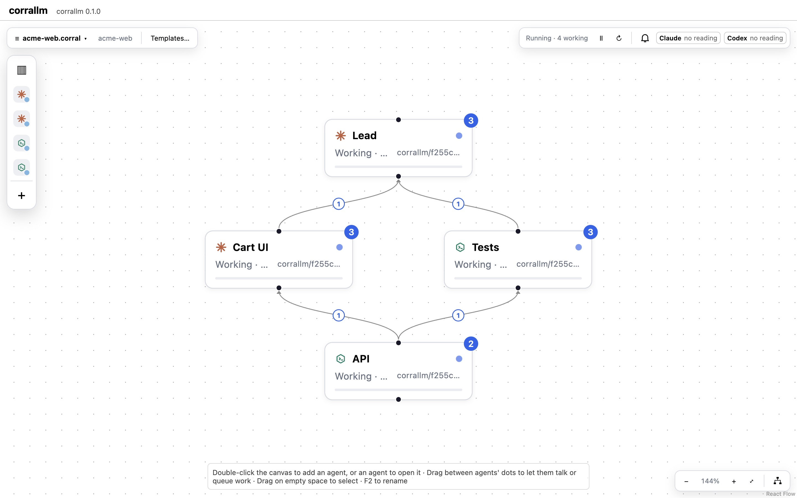
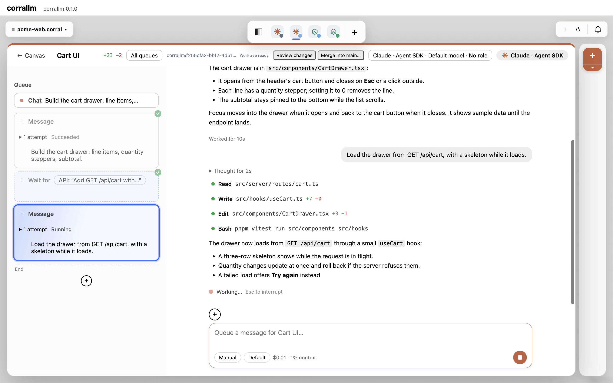
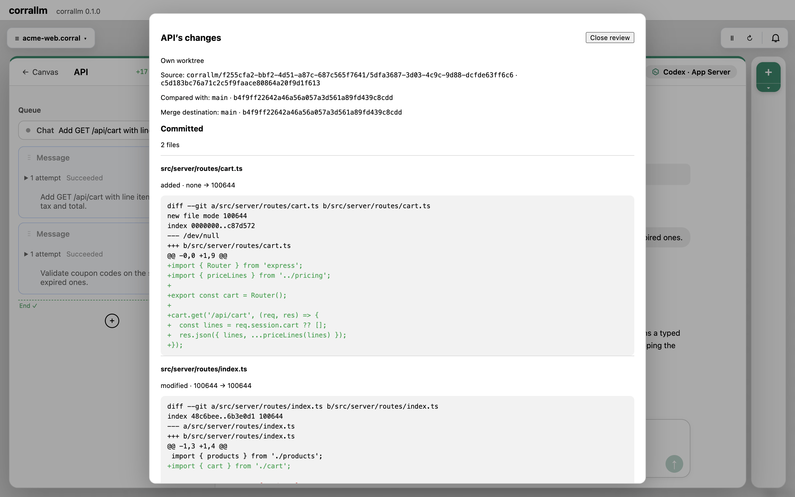

<p align="center">
  
</p>

# corrallm

**Run coding agents together, in workflows you can read and change.**

corrallm is a desktop app for running several coding agents on one canvas. Each agent is a real session of a coding CLI, today Claude Code or Codex, with a queue of work you can read and edit. A workflow, such as a test-first relay or a review panel, is a template: start a canvas from one, or combine several on one canvas as parts of a larger effort.

It is for developers who already run Claude Code and Codex and pass work between them by hand.

> **Not released yet.** There are no installers or releases. To try corrallm, [build it from source](#build-from-source).

corrallm runs the Claude Code and Codex CLIs you install, with your own logins and settings. It is an independent project, not made, endorsed or supported by Anthropic or OpenAI.


|  |         |
| :-------------------------------------------------------------------------------------------------------------------: | :----------------------------------------------------------------------------------------------: |
|                **The canvas.** Each agent is a card; arrows show the work one agent's queue waits on.                 |          **An agent's window.** Its queue beside its transcript, streaming as it works.          |
|          |  |
|                   **All queues.** Every queue side by side, each wait level with what it waits for.                   |              **Review changes.** What an agent's branch holds, before you merge it.              |

These pictures come from a demo canvas with scripted fake agents: `pnpm media` remakes them (see [toolchain](docs/architecture/toolchain.md)).

## Current status

| Area                                        | Status       | What is covered                                                                                                                                    |
| ------------------------------------------- | ------------ | -------------------------------------------------------------------------------------------------------------------------------------------------- |
| macOS and Linux; all four agent connections | Works now    | Unit tests, native protocol recordings and app journeys with fake CLIs. Login requirements are below.                                              |
| Canvases, queues, templates and recovery    | Works now    | Editable workflows, paused recovery and unsaved canvases kept across restarts.                                                                     |
| Branch review and local merge               | Works now    | Real-Git tests and app journeys; conflicts and changed review state are held for you.                                                              |
| Outside orchestration and leads             | Works now    | Scoped MCP tools, limited prompt delegation and backend-change proposals you approve.                                                              |
| Usage-driven fallback and handoffs          | Experimental | Tested with fake CLIs and controlled limits. The switch has run at a real Codex limit; carrying a handoff and returning automatically haven't yet. |
| Windows                                     | Unverified   | Main-branch checks are non-blocking; no shipped command, OS notifications or worktree setup execution.                                             |

## How it works

- **Agents.** Each agent runs its CLI in a git worktree of the canvas's project, on a branch of its own; a group shares one worktree. A project that isn't a Git repository is used as it is. You work with an agent in its own window: in the CLI's own terminal, or in corrallm's transcript and composer.
- **Queues.** Each agent has a queue: steps (what to do, in your words), messages, waits on another agent's work, delays, OKs that wait for you, if-thens and repeats. Steps use the agent's completion report or final verdict; a native failure, a missing verdict or disagreement holds the work for inspection. A step can be expected to fail, as a test written first should.
- **Templates.** corrallm ships ten, among them TDD relay (one agent writes the tests, another makes them pass, a third refactors), Head to head, Spec first and Review panel. Templates name jobs, not CLIs: you choose which CLI fills each role. Start a canvas from one, or insert one into a canvas.
- **You stay in charge.** All queues shows every queue side by side. A failed or uncertain task, and anything an agent asks you, waits in Needs you. Pause, Kill and Resume work per agent or per group. Review changes shows what an agent's branch holds, and Merge brings it into yours.
- **Settings.** Your default agent, OS notifications on or off, saved consents for each CLI, and sites whose links open without asking. You can take a consent back or forget a site there.
- **Quitting asks first.** If agents are working, quitting offers Quit and pause, Keep running or Cancel. Keep running closes the windows (on Linux, minimizes them) and leaves the agents going; reopen corrallm to see them again. corrallm tells you when something needs you, and keeps the computer awake while agents work.

## Sessions, recovery and delegation

Claude Code and Codex each have two connections: the CLI's own **Terminal**, or a structured transcript through **Agent SDK** (Claude Code) or **App Server** (Codex). Choose an agent explicitly, or save a default in Add, Start or Settings. Native models, efforts, modes and available actions come from each connection.

**Review changes** separates committed and uncommitted work. **Merge** prepares the result away from your checkout and installs it only by fast-forward after checking the reviewed state again. Conflicts and unexpected changes are held for you. A merge that would write through a repository filter is refused with the command you can run yourself.

Work keeps going when a window closes, reloads or switches canvases. After the core restarts, runs return paused and interrupted work is held for inspection; messages that may already have been sent are never replayed automatically. Each CLI keeps its native conversation history.

Queue hand-offs appear in the recipient's queue and use its reply as the task's evidence. A loop guard holds agent-to-agent exchanges after ten turns without your input, until you intervene.

You can make an agent a **lead** in Agent settings and choose whether it may answer its team's approvals, questions or plans. A lead can create helpers and use corrallm's MCP tools within its team. Its answers are limited to offered labels and permitted one-time choices. Trust, secrets, consent, forms and changes that grant lasting permissions stay yours. You can also grant an outside orchestrator limited one-time approval answers in **Outside orchestrators** in the canvas menu. Neither kind of grant makes a token you.

Usage gauges show each backend's reported windows. Rules can warn, ask, wait for a reset or use a **fallback chain**. Set the chain beside the agent chip or in **Agent settings → Fallback chain**. At a reported usage limit, corrallm can carry the held task to the next usable backend after the current turn ends, in a fresh conversation with the latest accepted handoff, if one exists. Automatic return to the original backend is opt-in and waits for its usage to allow work. You choose the chain; an outside writer can only propose a change for your approval. A connection with no reported usage, such as Agent SDK, never falls back on its own. See [fallback and handoffs](docs/architecture/usage.md#fallback-carrying-on-with-the-next-backend) for triggers and handoff limits.

The app and `corrallm serve` expose the same local MCP server. corrallm's agents each get their own session authority; an outside orchestrator uses a separate token scoped to the canvases you name. See [Drive corrallm from a terminal](#drive-corrallm-from-a-terminal).

## Requirements

- **The CLIs.** Claude Code, Codex or both, installed and logged in. Codex needs 0.160.0 or newer. The [Claude Code](docs/architecture/claude-code.md) and [Codex](docs/architecture/codex.md) connection docs give the versions each behaviour was recorded with. You can use one CLI throughout or combine them.
- **Git.** 2.36 or newer, since agents work in Git worktrees of your project; merging a branch locally needs 2.39 or newer.
- **Logins.** Both Terminal connections work with any login, a Claude or ChatGPT subscription included. The Agent SDK connection needs an Anthropic API key or a cloud provider (Bedrock, Vertex, Foundry or a gateway): Anthropic doesn't allow other products to use subscription logins through the Agent SDK. Codex's App Server works with an API key, or with your ChatGPT plan once you allow it.
- **Costs.** corrallm is free and open source. Your agents' work is billed to, or counted against, your own accounts, as when you run the CLIs yourself.

## Quickstart

1. [Build and run corrallm](#build-from-source): `pnpm dev`, or the app `pnpm package` builds in `out/`.
2. In **Start a session**, pick a template, for example **TDD relay**, fill in what it asks (what to build, and the test framework), and choose an agent and connection for every role. A known saved default prefills the roles. Press **Create canvas**.
3. On the new canvas, use **Choose a project folder…** to pick a Git repository's top-level folder, with at least one commit. Agents work in worktrees forked from the last commit, one each or one per group, so changes you haven't committed aren't in them.
4. Press **Run**. Open **Needs you** (the bell) to review each new worktree's setup: choose **Run** for its command, such as installing dependencies, **Always for this repository**, or **Skip**. Open an agent to watch it. The dock's **All queues** button shows every queue side by side, and **Needs you** lists what waits for you.

Queue progress and unsaved canvases survive a restart. Save the canvas to keep it as a file.

## Drive corrallm from a terminal

An orchestrator outside corrallm (Claude Code or Codex in another folder, or a script) can send a canvas's agents work through corrallm's local MCP server, registered as `corrallm-server`, and wait for what they send back. The app serves it with its window open or not; `corrallm serve` serves it with the app closed. Within its token's reach, an orchestrator can read permitted transcript and Needs views; a writer can also edit canvases and queues, send work, and pause, kill or interrupt agents. Human-only prompt details and settled records stay private.

1. **Prepare the command.** The packaged command ships its own Node; a source checkout uses the pinned Node from [Build from source](#build-from-source).
   - macOS: Settings → The corrallm command → Install. That links `~/.local/bin/corrallm` to the app's own command, with no password and no change to your shell's startup files; if `~/.local/bin` isn't on your PATH, Settings shows the line to add.
   - Linux: the deb or rpm installs `/usr/bin/corrallm`, and Settings shows it as installed.
   - From source: run `pnpm build:cli`, then `pnpm corrallm …` in the checkout (or `node dist-cli/corrallm.cjs …`). No PATH installation is needed: the printed file-based MCP registration uses the absolute running Node and bundle paths. Keep both in protected permanent locations, outside every canvas's project folder; temporary builds are refused as credential helpers. To install a PATH command instead, package the app and use Settings, or install a Linux package built with `pnpm make`.
   - Not on Windows yet.
2. **Open the canvas in the app**, choose its project folder there, and save it. corrallm runs a canvas only in the folder you picked in the app.
3. **Make a token**, in a terminal. First create its destination folder with `mkdir -p ~/.corrallm`, then run `corrallm token new --canvas path/to/canvas.corral --into ~/.corrallm/orchestrator.token`, replacing the canvas path with your saved file. The running app (or `serve`) answers it; with neither running, the command writes the token itself. With `--into`, the token goes only to that file, readable only by you; without it, it is shown once. A token lasts an hour unless you say `--hours` (12 at most), reaches only its granted canvases and canvases its party creates, and can write unless `--read-only`. Add `--no-merge` for a writer that cannot merge branches. corrallm keeps only its hash.
4. **Register corrallm in a folder of your orchestrator's own**, which must be no canvas's project folder, as `corrallm token` prints for each CLI you have. corrallm writes none of it.
   - Claude Code: run the printed `claude mcp add-json` line in that folder. It stays local to that folder and reads the token from the file each time it connects (`corrallm token header --from <file>`), so a renewal needs no restart. The printed helper keeps bare `corrallm` only when PATH resolves to this packaged command; otherwise it uses the packaged launcher's absolute path or the checkout's absolute Node and bundle paths, and says so. Keep those files in place, or make or renew the token and re-register after moving them.
   - Codex: add the printed text to that folder's `.codex/config.toml`, and trust the folder when Codex asks (an untrusted folder's file isn't loaded). Codex runs the same helper through a shell in that folder and reads the token from the file when it connects and again after a refused call, so a renewal needs no restart. It isn't registered for every folder, and uses the same helper-path selection as above.

   corrallm strips outside-token variables from its own agents' environment, and the token commands refuse to run inside one.

5. **Send work and wait.** Your orchestrator calls `message` to send an agent work, `status` and `messages` to see where things are, and `wait` for what comes back. For a wait longer than its client lets a tool call run, export `CORRALLM_OUTSIDE_TOKEN_FILE=~/.corrallm/orchestrator.token` in its shell and run `corrallm wait --for <message id>`, substituting the returned message id. It also accepts the token through `CORRALLM_OUTSIDE_TOKEN`. It finds the app's server by itself; for another profile, set `CORRALLM_URL` to the URL `serve` or `corrallm token` printed.
6. **Or serve without the app.** Quit the app (one corrallm owns a profile at a time), then run `corrallm serve --canvas path/to/canvas.corral`. It stops when its terminal closes, so run it in tmux or screen to keep it going.

For a source checkout, run the token command in step 3 as `pnpm corrallm token new …`; its printed registration works without a PATH installation. The helper holds only the 0600 token-file path, never the token. The profile owner refuses helper code in any remembered project folder (not just canvases the token reaches), in its profile, in system temporary folders, or under ancestors another user can write.

`corrallm token renew --into <file>` gives a token a new value and `corrallm token revoke` removes it; either takes effect at once.

**A token is never you.** It can't pick a file or folder, change an agent's mode, make or widen a token, or answer a human-only prompt. An outside writer's `agent.setType`, `agent.setConnection` or `agent.setFallback` raises a proposal; only your approval in Needs applies it, and a stale proposal is refused. Without your explicit approval grant, it cannot answer native prompts at all. A grant permits only eligible one-time approval choices, with no feedback, own words or lasting permission; a connection that cannot classify permission effects permits rejection only. Deleting an agent, or discarding what you might lose, also waits for your approval. Token renewal and revocation remain terminal commands, never MCP tools. See [security](docs/architecture/security.md) for the full boundaries.

An outside writer can also call `agent.return` to request a fallen-back agent's return to its own saved endpoint, including its model and effort. It cannot choose another target. The call promptly returns `{ accepted: true }` with revisions; that acknowledges the request, not a completed switch. Follow its `fallback` view through `status` or `agents`, and use `wait` for notices. The return waits for the current turn to end, requires the source backend to be usable, and respects pauses and other switch barriers. A client timeout or disconnect after acceptance does not cancel it.

### Headless over SSH

The Node CLI and `serve` need no graphical desktop, Electron's desktop libraries or WebGL2. From a checkout run `pnpm install`, `pnpm build:cli`, then `pnpm corrallm serve --canvas /path/to/canvas.corral`; keep Node and the checkout in protected permanent folders outside canvas projects. File-based MCP registration uses the absolute helper paths without installing a command. Initial canvas creation, folder selection, saving and worktree setup still need the app on that machine/profile; copying a canvas file alone is insufficient. Only one of the app and `serve` may own a profile at once.

See [Headless](docs/architecture/headless.md) for every command and option.

## Known limits

- **Not released.** Build from source. Packaged builds contain update support: signed macOS builds can download an update and ask to restart; Linux offers the newer release's page for manual installation. Development and unsigned macOS builds skip update checks.
- **Windows** is not validated for release. Its main-branch CI checks are non-blocking. The `corrallm` command and `corrallm token` aren't available there, and no worktree setup command runs there.
- **Linux** is checked on arm64 and x64. Terminal agents need WebGL2 (in a virtual machine, turn on 3D acceleration).
- **Closing a window.** On macOS, closing a window never stops a run and asks nothing; the Dock icon stays. On Linux, closing the last window while agents work asks the quit question, and Keep running minimizes the window. A window closing or reloading never ends a run.
- **Notifications.** Turn them off in Settings. Clicking one opens its canvas and focuses its Needs item if it is still current; if its target is no longer available, corrallm opens its window. The macOS Dock badge counts what needs you, and its menu-bar item can reopen the window while work runs. Linux has a tray icon. Windows has no tray icon or OS notifications.
- **Test coverage has limits.** Fallback is experimental as noted above. Native notifications, signing and desktop integration also depend on the host OS; packaged checks and fake-based tests cannot cover every desktop environment.
- **Shared folders.** Agents in a group share one worktree, and the agents of a project that isn't a Git repository share its folder, so two of them editing at once can collide.
- **Worktrees need a filesystem that reports file creation time.** corrallm uses it to tell its own worktree folder from a replacement; on a filesystem that reports none, creating a worktree fails.
- **Worktrees won't be written through a link.** A repository that symlinks its Git metadata (`.git/worktrees`, `refs`, `logs`, `packed-refs` or `reftable`) gets no per-agent worktrees: creating them fails.
- **A taken port.** If another program holds the port corrallm keeps for MCP, the app says so and doesn't serve it; it never picks another port. Quit the app and run `corrallm serve --port <n> --canvas …` once: `serve` keeps that port, so the app uses it from then on. Then register corrallm again at the new URL. If corrallm ever says its port is taken, revoke your token (`corrallm token revoke`) and make a new one: whatever held the port may have received it.
- **Human-only prompts under `serve`.** There is no window in which you can answer them. A configured lead or explicitly granted outside orchestrator may answer only its eligible prompts; an outside token sees only its authorized projection and can interrupt a reached agent. A prompt handed to the native terminal needs someone at that terminal, which `serve` does not display. Choose a structured connection for unattended work and expect human-only prompts to hold it.
- **Hooks.** If your or your organization's Claude Code settings turn hooks off, corrallm can't read a Terminal agent's replies, and says so.
- **Structured connections.** Native requests that corrallm cannot represent faithfully are declined with a notice rather than partially answered. Agent SDK agents run on API credit, which has no usage windows, so usage rules don't apply to them.

## Build from source

| Tool    | Version                              | Notes                                                                      |
| ------- | ------------------------------------ | -------------------------------------------------------------------------- |
| Node.js | 24.22.1 (pinned in `.nvmrc`)         | Use the pinned version for reproducible builds                             |
| pnpm    | 12.11.2 (pinned in `packageManager`) | pnpm switches itself to the pinned version automatically                   |
| Git     | 2.39+                                | Worktrees need 2.36 and local merges 2.39; corrallm won't use an older Git |

```sh
git clone https://github.com/jrbarkin/corrallm.git
cd corrallm
pnpm install      # also sets up the Git pre-commit hook
pnpm dev          # run the app with Vite hot reload
pnpm package      # or build the app for this OS into out/
pnpm build:cli    # build the corrallm command into dist-cli/
pnpm corrallm --help
```

**Node.** Use a version manager that reads `.nvmrc`: [fnm](https://github.com/Schniz/fnm) (`fnm install`, with `eval "$(fnm env --use-on-cd)"` in your shell's startup file), nvm, or nvm-windows 2.x. With nvm-windows 1.x or Volta, install 24.22.1 explicitly.

**pnpm.** Install it as a standalone executable (`curl -fsSL https://get.pnpm.io/install.sh | sh -` on macOS and Linux, `npx get-pnpm` on Windows), not through Corepack, which Node 25 removed.

**Platform tools.**

- **macOS:** Xcode Command Line Tools (`xcode-select --install`). The DMG maker's dependencies compile small native add-ons during install.
- **Windows:** nothing extra.
- **Linux:** a graphical desktop with Electron's system libraries (including GTK, NSS and ALSA) and WebGL2. The [Linux build environment](scripts/lib/linux-build.Dockerfile) lists the dependencies used in CI. To build installers with `pnpm make`, install `dpkg` and `rpm`.

The Electron binary is downloaded the first time it is needed; `pnpm exec install-electron` fetches it up front. node-pty ships prebuilt binaries, so the terminal module needs no C++ build toolchain.

Stop the development app before opening the production build: only one corrallm owns a profile at a time. After `pnpm package`, use `open out/corrallm-darwin-*/corrallm.app` on macOS, or `./out/corrallm-linux-*/corrallm` on Linux.

## Development

corrallm is an Electron app built with Electron Forge, Vite, React and TypeScript. [AGENTS.md](AGENTS.md) holds the development rules, and [the architecture overview](docs/architecture/overview.md) maps each area to its doc. Run `pnpm typecheck`, `pnpm lint` and `pnpm format:check`, then `pnpm test:fast` and `pnpm test:e2e:smoke` for local checks. `pnpm test` runs the full unit suite, including crash and store-performance tests; `pnpm test:e2e` builds the unsigned app and runs all Playwright journeys. See [toolchain](docs/architecture/toolchain.md) for the full command list.

While `pnpm dev` runs, renderer changes update in place and preload changes reload the window. Main-process changes are rebuilt, but the app keeps running the old code until you press `r` in the Forge terminal. Changes to `forge.config.mts`, `vite.*.config.mts` or `package.json` need `pnpm dev` started again.

GitHub CI runs on every pushed branch and fork pull request: the full unit suite, packaging and packaged self-tests on macOS and Linux, and end-to-end tests on both. Windows checks run on main only and do not block a merge. Before a release, also run on macOS `pnpm package` and `scripts/check-macos.sh`, which checks the packaged bundle's signature, native self-test, refused launch switches and shipped command. For Linux, with Docker running, use `scripts/ci-linux.sh`, `scripts/e2e-linux.sh` (its end-to-end tests alone), `scripts/check-linux.sh` and `scripts/check-linux-packages.sh`, each with `arm64` or `x64` (x64 is slow under emulation on Apple Silicon). The maintainer makes release drafts with `scripts/release.sh`. See [toolchain](docs/architecture/toolchain.md).

To check a packaged build without opening it, run its binary with `CORRALLM_NATIVE_SELFTEST=1`. The [native self-test](docs/architecture/native-modules.md) exercises the app, core process and shipped command without a login.

In VS Code, the **Electron: Main + Renderer** launch configuration runs the app under the main-process debugger and attaches a Chrome debugger to the window.

Signing and notarization turn on only when their environment variables are set: copy `.env.example` to `.env` (git-ignored). Never commit real credentials.

### Troubleshooting

- **`ERR_PNPM_IGNORED_BUILDS` during install:** a dependency wants to run a build script that hasn't been approved. Review it, then add it to `allowBuilds` in `pnpm-workspace.yaml`.
- **Engine or version errors:** check that `node --version` prints v24.22.1 or a later 24.x (run `fnm use` in the repo root).
- **A package is "too new":** pnpm refuses versions published less than a day ago (`minimumReleaseAge`). Wait a day rather than adding exclusions.
- **Forge complains about pnpm's node linker:** `nodeLinker: hoisted` must stay in `pnpm-workspace.yaml`. pnpm 11+ ignores this setting in `.npmrc`.
- **Electron fails to start on Ubuntu 24.04+ with a sandbox error:** AppArmor blocks the unprivileged user namespaces Chromium's sandbox uses. Allow them with `sudo sysctl -w kernel.apparmor_restrict_unprivileged_userns=0`. Don't disable the sandbox.
- **A Terminal agent's view says its terminal needs WebGL2:** corrallm draws terminals with the GPU, and the production CSP rules out a fallback that would draw them unstyled. In a virtual machine, turn on 3D acceleration; over remote desktop (xrdp, VNC), use the computer's own display; otherwise update or enable its graphics driver. Then reopen the view, or restart corrallm. The CLI keeps running meanwhile.
- **Headless Linux tests lack a display or WebGL2:** with Docker running, use `scripts/e2e-linux.sh` with `x64` (or `arm64`). It configures Xvfb and Mesa for the production renderer. A bare Xvfb display alone may not provide the WebGL2 context the tests require.

## Contributing and security

Pull requests are welcome: see [CONTRIBUTING.md](CONTRIBUTING.md). Each contributed commit needs a `Signed-off-by:` trailer under the Developer Certificate of Origin, and contributions use the project's Apache-2.0 license.

Report vulnerabilities privately, as [SECURITY.md](SECURITY.md) says, never in a public issue.

## License

[Apache License 2.0](LICENSE).

The optional Agent SDK connection bundles Anthropic's `@anthropic-ai/claude-agent-sdk` (© Anthropic PBC, all rights reserved). Its use is governed by Anthropic's Commercial Terms of Service, and it is not covered by corrallm's Apache-2.0 license. corrallm runs your own installed `claude`, never a bundled copy. See [NOTICE](NOTICE).
