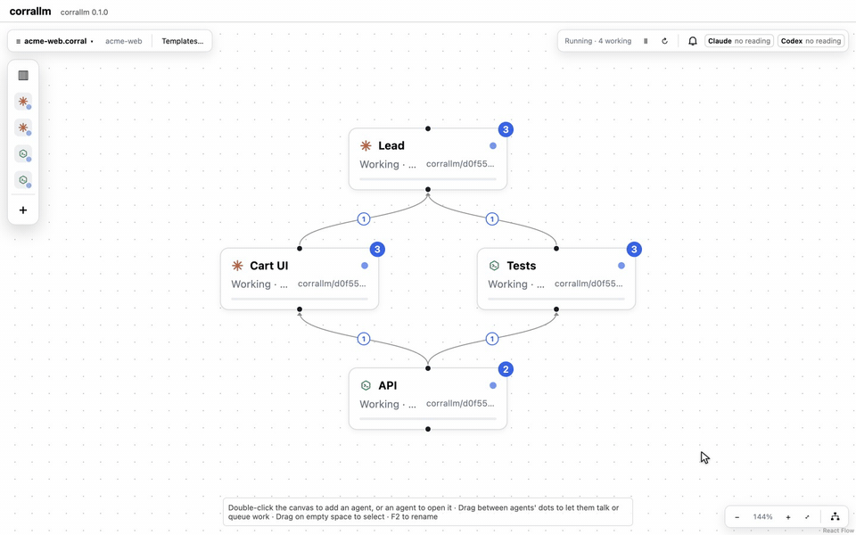
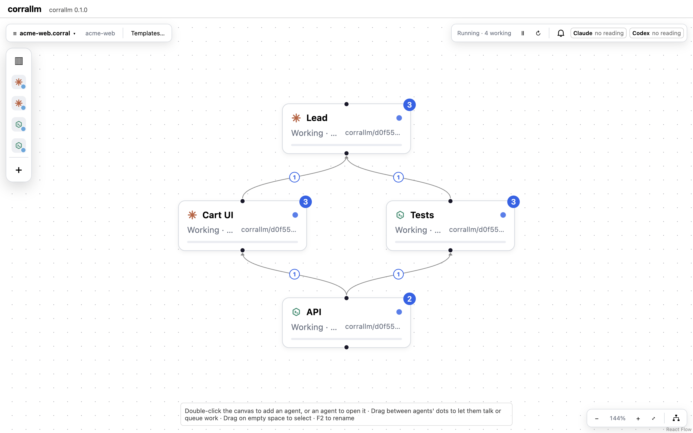
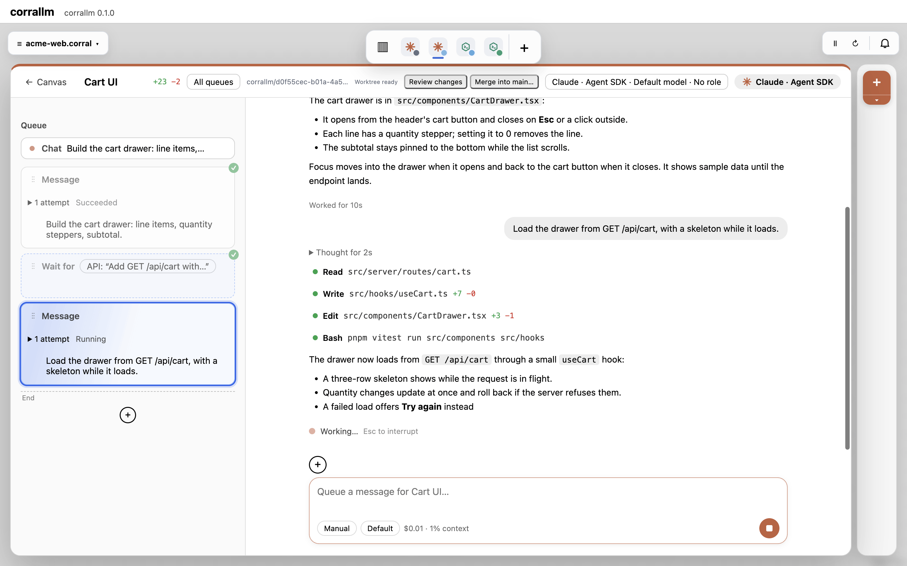
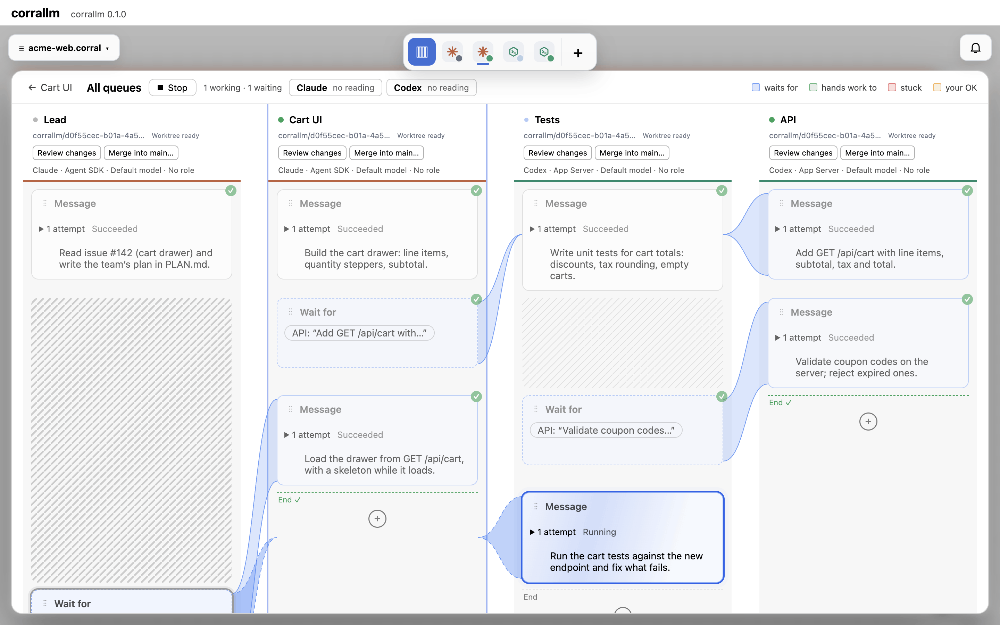
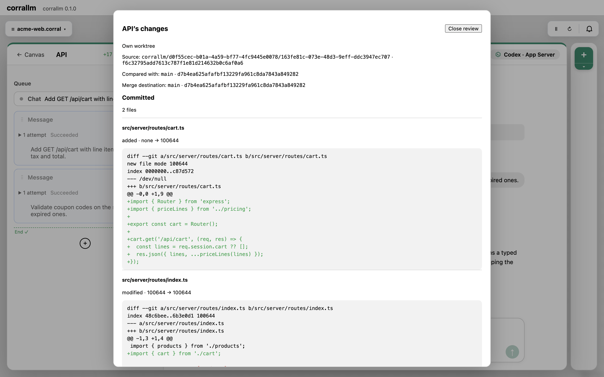

# corrallm

**Run coding agents together, in workflows you can read and change.**

corrallm is a desktop app for running several coding agents on one canvas. Each agent is a real session of a coding CLI, today Claude Code or Codex, with a queue of work you can read and edit. A workflow, such as a test-first relay or a review panel, is a template: start a canvas from one, or combine several on one canvas as parts of a larger effort.

It is for developers who already run Claude Code and Codex and pass work between them by hand.

> **Not released yet.** There are no installers or releases. To try corrallm, [build it from source](#build-from-source).

corrallm runs the Claude Code and Codex CLIs you install, with your own logins and settings. It is an independent project, not made, endorsed or supported by Anthropic or OpenAI.



|  |         |
| :-------------------------------------------------------------------------------------------------------------------: | :----------------------------------------------------------------------------------------------: |
|                **The canvas.** Each agent is a card; arrows show the work one agent's queue waits on.                 |          **An agent's window.** Its queue beside its transcript, streaming as it works.          |
|          |  |
|                   **All queues.** Every queue side by side, each wait level with what it waits for.                   |              **Review changes.** What an agent's branch holds, before you merge it.              |

These pictures come from a demo canvas with scripted fake agents: `pnpm media` remakes them (see [toolchain](docs/architecture/toolchain.md)).

## How it works

- **Agents.** Each agent runs its CLI in a git worktree of the canvas's project, on a branch of its own; a group shares one worktree. A project that isn't a Git repository is used as it is. You work with an agent in its own window: in the CLI's own terminal, or in corrallm's transcript and composer.
- **Queues.** Each agent has a queue: steps (what to do, in your words), messages, waits on another agent's work, delays, OKs that wait for you, if-thens and repeats. A step passes or fails as the agent says at the end of its reply. A step can be expected to fail, as a test written first should.
- **Templates.** corrallm ships ten, among them TDD relay (Codex writes the tests, Claude makes them pass, Codex refactors), Head to head, Spec first and Review panel. Start a canvas from one, or insert one into a canvas.
- **You stay in charge.** All queues shows every queue side by side. A failed or uncertain task, and anything an agent asks you, waits in Needs you. Pause, Kill and Resume work per agent or per group.
- **Quitting asks first.** If agents are working, quitting offers Quit and pause, Keep running or Cancel. Keep running closes the windows (on Linux, minimizes them) and leaves the agents going; reopen corrallm to see them again. corrallm tells you when something needs you, and keeps the computer awake while agents work.

## What works today, and what the first release adds

| Area                    | Works today, on `main`                                                                                                                                                                                                                                                                                                                                                                                                                                                                                                                                                                                                                                                            | The first release adds                                                                                                                                                                                                                                                      |
| ----------------------- | --------------------------------------------------------------------------------------------------------------------------------------------------------------------------------------------------------------------------------------------------------------------------------------------------------------------------------------------------------------------------------------------------------------------------------------------------------------------------------------------------------------------------------------------------------------------------------------------------------------------------------------------------------------------------------- | --------------------------------------------------------------------------------------------------------------------------------------------------------------------------------------------------------------------------------------------------------------------------- |
| CLIs                    | Claude Code and Codex. Each runs in its own terminal, or through a structured connection: the Agent SDK for Claude, the App Server for Codex.                                                                                                                                                                                                                                                                                                                                                                                                                                                                                                                                     | No CLI preferred: corrallm asks which to use until you choose a default.                                                                                                                                                                                                    |
| Workflows               | Canvases, queues and ten templates, which you can combine on one canvas. Most templates name the CLI for each role.                                                                                                                                                                                                                                                                                                                                                                                                                                                                                                                                                               | Templates name no CLI: you choose each role's.                                                                                                                                                                                                                              |
| Watching and steering   | All queues, Needs you, Pause, Kill and Resume. The run lives in the core, so it keeps going when its window closes or reloads. After a restart, runs come back paused, on the same native conversations, and nothing you sent is replayed. Quitting while agents work asks first: Quit and pause, Keep running or Cancel. On macOS the Dock icon badges what needs you, and a menu-bar item shows how many agents are working, with Open, Pause all and Quit, while no window is shown. On Linux a tray icon does the same. An OS notification says when something needs you or a run ends, only while no corrallm window is focused. The computer stays awake while agents work. | Notifications that open what they are about, and a setting to turn them off.                                                                                                                                                                                                |
| Parallel work           | Every agent works in a git worktree of its own, on its own branch, forked from your project's last commit; the agents of a group share one. Nine of the ten templates put their agents in one worktree, so one agent's uncommitted tests and code reach the next; Head to head gives its contestants and its judge a worktree each. A new worktree first asks in Needs you to run its setup, such as installing dependencies. Deleting an agent whose worktree holds work asks you; kept worktrees are listed in Canvases, each with Remove.                                                                                                                                      | Each agent's diff, and a local merge into your branch.                                                                                                                                                                                                                      |
| Agents working together | Hand-offs you write into queues. An orchestrator outside corrallm can drive a canvas's agents over MCP.                                                                                                                                                                                                                                                                                                                                                                                                                                                                                                                                                                           | corrallm's own agents use its tools over MCP: they message and wait on each other, ask you, and say when they're done. A lead runs a team: you give it the work, and it spawns helpers and, where you allow it, answers their questions, Terminal agents' prompts included. |
| Usage                   | A gauge per backend for its 5-hour and weekly windows. Rules that warn, ask or wait for the reset. A hit limit holds that backend's agents until it resets. Queue if-thens and delays on usage.                                                                                                                                                                                                                                                                                                                                                                                                                                                                                   | Fallback: an agent that runs out of usage carries on with the next backend in the chain you set, from the handoff it keeps current itself as its context fills. It needs another backend with usage left.                                                                   |
| Headless                | `corrallm serve`, its MCP server, `corrallm token` and `corrallm wait`, built from source. The app serves the same MCP server itself while it runs, window or not, and `corrallm token` and `corrallm wait` work against it; `serve` is for when the app is closed.                                                                                                                                                                                                                                                                                                                                                                                                               | The `corrallm` command installed from the app. Headless is supported at launch, not experimental.                                                                                                                                                                           |
| Platforms               | macOS, and Linux (checked on arm64 and x64).                                                                                                                                                                                                                                                                                                                                                                                                                                                                                                                                                                                                                                      | Signed builds that update themselves, for macOS, Linux and Windows (Windows last, once it has been tested).                                                                                                                                                                 |

Opening pull requests, more CLIs over the Agent Client Protocol, and managing outside tokens in the app come after the first release.

## Requirements

- **The CLIs.** Claude Code, Codex or both, installed and logged in. Most templates use both.
- **Logins.** Both Terminal connections work with any login, a Claude or ChatGPT subscription included. The Agent SDK connection needs an Anthropic API key or a cloud provider (Bedrock, Vertex, Foundry or a gateway): Anthropic doesn't allow other products to use subscription logins through the Agent SDK. Codex's App Server works with an API key, or with your ChatGPT plan once you allow it.
- **Costs.** corrallm is free and open source. Your agents' work is billed to, or counted against, your own accounts, as when you run the CLIs yourself.

## Quickstart

1. [Build and run corrallm](#build-from-source): `pnpm dev`, or the app `pnpm package` builds in `out/`.
2. In **Start a session**, choose a project folder: a Git repository's top-level folder, with at least one commit. Agents work in worktrees forked from the last commit, one each or one per group, so changes you haven't committed aren't in them.
3. Pick a template, for example **TDD relay**, fill in what it asks (what to build, and the test framework), and start it.
4. Press **Run**. Each new worktree first asks in **Needs you** to run its setup, such as installing dependencies: Run it, or Skip. Open an agent to watch it. **All queues** shows every queue; **Needs you** lists what waits for you.

Queue progress and unsaved canvases survive a restart. Save the canvas to keep it as a file.

When you quit while agents are working, corrallm asks. **Quit and pause** ends their sessions and each run opens paused next time. **Keep running** leaves everything going with the windows closed (on Linux, minimized): open corrallm from the Dock, the menu-bar item or the tray, or start it again. The first time an agent works, your system may ask to allow notifications.

## Drive corrallm from a terminal

An orchestrator outside corrallm (Claude Code or Codex in another folder, or a script) can send a canvas's agents work through corrallm's MCP server, registered as `corrallm-server`, and wait for what they send back. The app serves that server itself while it runs, with its window open or not; `corrallm serve` serves it with the app closed. Its tools also read transcripts and what waits for you, edit canvases and queues, and pause, kill or interrupt agents.

1. **Build the command.** From your checkout, `pnpm build:cli`, then run it as `pnpm corrallm …`. A build from `pnpm package` also holds it, at `corrallm.app/Contents/Resources/bin/corrallm` on macOS and `resources/bin/corrallm` on Linux. It isn't available on Windows yet.
2. **Open the canvas in the app**, choose its project folder there, and save it. corrallm runs a canvas only in the folder you picked in the app.
3. **Make a token**, in a terminal: `corrallm token new --canvas path/to/canvas.corral --into ~/.corrallm/orchestrator.token`. The running app (or `serve`) answers it at once; with neither running, it writes the token itself. With `--into`, the token goes only to that file, readable only by you; without it, it is shown once. A token lasts an hour unless you say `--hours` (12 at most), reaches only the canvases you name, and can write unless `--read-only`. corrallm keeps only its hash.
4. **Register corrallm** in your orchestrator's folder, which must be no canvas's project folder, with the command `corrallm token` printed for each CLI you have. Claude Code's reads the token from the file each time it connects (`corrallm token header --from <file>`); Codex's reads it from `CORRALLM_OUTSIDE_TOKEN` as Codex starts. Claude Code's registration stays local to that folder. Codex's is user-wide but holds no token, and corrallm strips outside-token variables from its own agents' environment.
5. **Send work and wait.** Your orchestrator calls `message` to send an agent work, `status` and `messages` to see where things are, and `wait` for what comes back. For a wait longer than its client lets a tool call run, it runs `corrallm wait --for <message id>`, which reads the token from `CORRALLM_OUTSIDE_TOKEN`, or from the file `CORRALLM_OUTSIDE_TOKEN_FILE` names.
6. **Or serve without the app.** Quit the app (one corrallm owns a profile at a time), then run `corrallm serve --canvas path/to/canvas.corral`. It stops when its terminal closes, so run it in tmux or screen to keep it going.

`corrallm token renew --into <file>` gives a token a new value and `corrallm token revoke` removes it; either takes effect at once.

**A token is never you.** It can't answer what an agent asks you, pick a file or folder, change an agent's mode, connection or CLI, or make, renew or widen a token. Deleting an agent, or discarding what you might lose, waits for you to allow it in the app.

See [Headless](docs/architecture/headless.md) for every command and option.

## Known limits

- **Not released.** No installers, signed builds or updates yet.
- **Windows** hasn't been tested. The `corrallm` command and `corrallm token` aren't available there, and no worktree setup command runs there.
- **Linux** is checked on arm64 and x64. Terminal agents need WebGL2 (in a virtual machine, turn on 3D acceleration).
- **Closing a window.** On macOS, closing a window never stops a run and asks nothing; the Dock icon stays. On Linux, closing the last window while agents work asks the quit question, and Keep running minimizes the window. A window closing or reloading never ends a run.
- **Notifications.** They are always on, with no setting to turn them off yet. Clicking one brings corrallm forward but doesn't yet open the canvas or item it names. Windows has no tray or notifications yet.
- **Checked only with fakes so far.** The permission prompt, Dock badge, menu-bar item and logout in a signed macOS build, and the tray and notifications on a real Linux desktop, haven't been tried by hand yet, so expect rough edges.
- **Shared folders.** Agents in a group share one worktree, and the agents of a project that isn't a Git repository share its folder, so two of them editing at once can collide.
- **Worktrees need a filesystem that reports file creation time.** corrallm uses it to tell its own worktree folder from a replacement; on a filesystem that reports none, creating a worktree fails.
- **Worktrees won't be written through a link.** A repository that symlinks its Git metadata (`.git/worktrees`, `refs`, `logs`, `packed-refs` or `reftable`) gets no per-agent worktrees: creating them fails.
- **A taken port.** If another program holds the port corrallm keeps for MCP, the app says so and doesn't serve it; it never picks another port.
- **Under `serve`, nothing answers what an agent asks you.** `serve` prints it, and your orchestrator sees it and can interrupt the turn. A Terminal agent's prompts can be answered only in its terminal, which nobody sees under `serve`. Give headless agents work that needs no approvals, on a structured connection.
- **Hooks.** If your or your organization's Claude Code settings turn hooks off, corrallm can't read a Terminal agent's replies, and says so.
- **Structured connections.** Through Codex's App Server, a prompt that asks more than four questions shows only the first four. Agent SDK agents run on API credit, which has no usage windows, so usage rules don't apply to them.

## Build from source

| Tool    | Version                              | Notes                                                       |
| ------- | ------------------------------------ | ----------------------------------------------------------- |
| Node.js | 24.22.1 (LTS, pinned in `.nvmrc`)    | One patch ahead of Electron 44's Node (24.22.0), on purpose |
| pnpm    | 12.11.2 (pinned in `packageManager`) | pnpm switches itself to the pinned version automatically    |
| Git     | 2.32+                                | Required by the pre-commit hooks                            |

```sh
git clone https://github.com/jrbarkin/corrallm.git
cd corrallm
pnpm install      # also sets up the Git pre-commit hook
pnpm dev          # run the app with Vite hot reload
pnpm package      # or build the app for this OS into out/
pnpm build:cli    # build the corrallm command into dist-cli/
```

**Node.** Use a version manager that reads `.nvmrc`: [fnm](https://github.com/Schniz/fnm) (`fnm install`, with `eval "$(fnm env --use-on-cd)"` in your shell's startup file), nvm, or nvm-windows 2.x. With nvm-windows 1.x or Volta, install 24.22.0 explicitly.

**pnpm.** Install it as a standalone executable (`curl -fsSL https://get.pnpm.io/install.sh | sh -` on macOS and Linux, `npx get-pnpm` on Windows), not through Corepack, which Node 25 removed.

**Platform tools.**

- **macOS:** Xcode Command Line Tools (`xcode-select --install`). The DMG maker's dependencies compile small native add-ons during install.
- **Windows:** nothing extra.
- **Linux:** nothing extra to build or run the app. To build installers with `pnpm make`, install `dpkg` and `rpm`.

The Electron binary (about 100 MB) is downloaded the first time it is needed; `pnpm exec install-electron` fetches it up front. node-pty ships prebuilt binaries for every supported platform, so no C++ toolchain is needed.

To try the production build, run `pnpm package` and open the app in `out/` (for example `open out/corrallm-darwin-arm64/corrallm.app`).

## Development

corrallm is an Electron app built with Electron Forge, Vite, React and TypeScript. [AGENTS.md](AGENTS.md) holds the development rules, and [the architecture overview](docs/architecture/overview.md) maps each area to its doc.

| Script           | What it does                                                           |
| ---------------- | ---------------------------------------------------------------------- |
| `pnpm dev`       | Run the app in development mode                                        |
| `pnpm typecheck` | Type-check all TypeScript projects                                     |
| `pnpm lint`      | ESLint (type-aware rules)                                              |
| `pnpm format`    | Format all files with Prettier                                         |
| `pnpm test`      | Unit tests (Vitest) for main, preload, renderer and store-performance  |
| `pnpm test:e2e`  | Build the app (unsigned) and run the Playwright tests                  |
| `pnpm package`   | Package the app for the current OS into `out/`                         |
| `pnpm make`      | Build installers for the current OS into `out/make/`                   |
| `pnpm media`     | Remake the screenshots and GIF above, in `docs/images/` (needs ffmpeg) |

While `pnpm dev` runs, renderer changes update in place and preload changes reload the window. Main-process changes are rebuilt, but the app keeps running the old code until you press `r` in the Forge terminal. Changes to `forge.config.mts`, `vite.*.config.mts` or `package.json` need `pnpm dev` started again.

Local CI runs on your machine for now: the done gate in [AGENTS.md](AGENTS.md), then on macOS `pnpm package` and `scripts/check-macos.sh`, which checks the packaged bundle's signature, the native self-test, the refused launch switches and the shipped command. For Linux, with Docker running, use `scripts/ci-linux.sh`, `scripts/check-linux.sh` and `scripts/check-linux-packages.sh`, each with `arm64` or `x64` (x64 is slow under emulation on Apple Silicon). See [toolchain](docs/architecture/toolchain.md).

To check a packaged build without opening it, run it with `CORRALLM_NATIVE_SELFTEST=1` (for example `CORRALLM_NATIVE_SELFTEST=1 out/corrallm-darwin-arm64/corrallm.app/Contents/MacOS/corrallm`). It checks node-pty, the terminal's screen copy, the Agent SDK, SQLite, loopback HTTP and spawning in its main process, its core process and the shipped command, needs no login, and exits with 0.

In VS Code, the **Electron: Main + Renderer** launch configuration runs the app under the main-process debugger and attaches a Chrome debugger to the window.

Signing and notarization turn on only when their environment variables are set: copy `.env.example` to `.env` (git-ignored). Never commit real credentials.

### Troubleshooting

- **`ERR_PNPM_IGNORED_BUILDS` during install:** a dependency wants to run a build script that hasn't been approved. Review it, then add it to `allowBuilds` in `pnpm-workspace.yaml`.
- **Engine or version errors:** check that `node --version` prints v24.22.1 or a later 24.x (run `fnm use` in the repo root).
- **A package is "too new":** pnpm refuses versions published less than a day ago (`minimumReleaseAge`). Wait a day rather than adding exclusions.
- **Forge complains about pnpm's node linker:** `nodeLinker: hoisted` must stay in `pnpm-workspace.yaml`. pnpm 11+ ignores this setting in `.npmrc`.
- **Electron fails to start on Ubuntu 24.04+ with a sandbox error:** AppArmor blocks the unprivileged user namespaces Chromium's sandbox uses. Allow them with `sudo sysctl -w kernel.apparmor_restrict_unprivileged_userns=0`. Don't disable the sandbox.
- **A Terminal agent's view says its terminal needs WebGL2:** corrallm draws terminals with the GPU, and the production CSP rules out a fallback that would draw them unstyled. In a virtual machine, turn on 3D acceleration; over remote desktop (xrdp, VNC), use the computer's own display; otherwise update or enable its graphics driver. Then reopen the view, or restart corrallm. The CLI keeps running meanwhile.
- **`pnpm test:e2e` on headless Linux fails with "Missing X server or $DISPLAY":** install Xvfb (`sudo apt-get install xvfb`) and run `xvfb-run -a pnpm test:e2e`.

## Contributing and security

Pull requests are welcome: see [CONTRIBUTING.md](CONTRIBUTING.md). Each contributed commit needs a `Signed-off-by:` trailer under the Developer Certificate of Origin, and contributions use the project's Apache-2.0 license.

Report vulnerabilities privately, as [SECURITY.md](SECURITY.md) says, never in a public issue.

## License

[Apache License 2.0](LICENSE).

The optional Agent SDK connection bundles Anthropic's `@anthropic-ai/claude-agent-sdk` (© Anthropic PBC, all rights reserved). Its use is governed by Anthropic's Commercial Terms of Service, and it is not covered by corrallm's Apache-2.0 license. corrallm runs your own installed `claude`, never a bundled copy. See [NOTICE](NOTICE).
