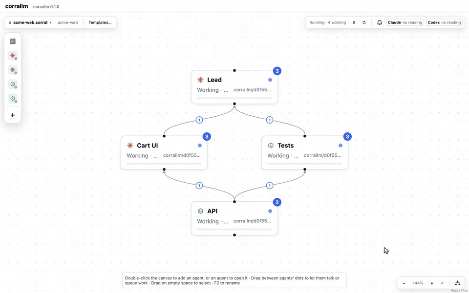
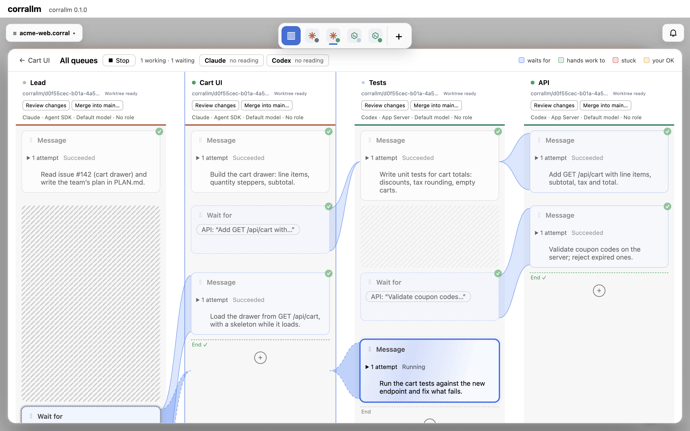

<p align="center">
  
</p>

# corrallm

**Run coding agents together, in workflows you can read and change.**

corrallm is a desktop app for running several coding agents on one canvas. Each agent is a real session of a coding CLI, today Claude Code or Codex, with a queue of work you can read and edit. A workflow, such as a test-first relay or a review panel, is a template: start a canvas from one, or combine several on one canvas as parts of a larger effort.

It is for developers who already run Claude Code and Codex and pass work between them by hand.

> **Not released yet.** There are no installers or releases. To try corrallm, [build it from source](#build-from-source).

corrallm runs the Claude Code and Codex CLIs you install, with your own logins and settings. It is an independent project, not made, endorsed or supported by Anthropic or OpenAI.



|  |         |
| :-------------------------------------------------------------------------------------------------------------------: | :----------------------------------------------------------------------------------------------: |
|                **The canvas.** Each agent is a card; arrows show the work one agent's queue waits on.                 |          **An agent's window.** Its queue beside its transcript, streaming as it works.          |
|          |  |
|                   **All queues.** Every queue side by side, each wait level with what it waits for.                   |              **Review changes.** What an agent's branch holds, before you merge it.              |

These pictures come from a demo canvas with scripted fake agents: `pnpm media` remakes them (see [toolchain](docs/architecture/toolchain.md)).

## Current status

| Area                                        | Status       | What is covered                                                                                                                                    |
| ------------------------------------------- | ------------ | -------------------------------------------------------------------------------------------------------------------------------------------------- |
| macOS and Linux; all four agent connections | Works now    | Unit tests, native protocol recordings and app journeys with fake CLIs. Login requirements are below.                                              |
| Canvases, queues, templates and recovery    | Works now    | Editable workflows, paused recovery and unsaved canvases kept across restarts.                                                                     |
| Branch review and local merge               | Works now    | Real-Git tests and app journeys; conflicts and changed review state are held for you.                                                              |
| Outside orchestration and leads             | Works now    | Scoped MCP tools, limited prompt delegation and backend-change proposals you approve.                                                              |
| Usage-driven fallback and handoffs          | Experimental | Tested with fake CLIs and controlled limits. The switch has run at a real Codex limit; carrying a handoff and returning automatically haven't yet. |
| Windows                                     | Unverified   | Main-branch checks are non-blocking; no shipped command, OS notifications or worktree setup execution.                                             |

## How it works

- **Agents.** Each agent runs its CLI in a git worktree of the canvas's project, on a branch of its own; a group shares one worktree. A project that isn't a Git repository is used as it is. You work with an agent in its own window: in the CLI's own terminal, or in corrallm's transcript and composer.
- **Queues.** Each agent has a queue: steps (what to do, in your words), messages, waits on another agent's work, delays, OKs that wait for you, if-thens and repeats. Steps use the agent's completion report or final verdict; a native failure, a missing verdict or disagreement holds the work for inspection. A step can be expected to fail, as a test written first should.
- **Templates.** corrallm ships ten, among them TDD relay (one agent writes the tests, another makes them pass, a third refactors), Head to head, Spec first and Review panel. Templates name jobs, not CLIs: you choose which CLI fills each role. Start a canvas from one, or insert one into a canvas.
- **You stay in charge.** All queues shows every queue side by side. A failed or uncertain task, and anything an agent asks you, waits in Needs you. Pause, Kill and Resume work per agent or per group. Review changes shows what an agent's branch holds, and Merge brings it into yours.
- **Settings.** Your default agent, OS notifications on or off, saved consents for each CLI, and sites whose links open without asking. You can take a consent back or forget a site there.
- **Quitting asks first.** If agents are working, quitting offers Quit and pause, Keep running or Cancel. Keep running closes the windows (on Linux, minimizes them) and leaves the agents going; reopen corrallm to see them again. corrallm tells you when something needs you, and keeps the computer awake while agents work.

## Sessions, recovery and delegation

Claude Code and Codex each have two connections: the CLI's own **Terminal**, or a structured transcript through **Agent SDK** (Claude Code) or **App Server** (Codex). Choose an agent explicitly, or save a default in Add, Start or Settings. Native models, efforts, modes and available actions come from each connection.

**Review changes** separates committed and uncommitted work. **Merge** prepares the result away from your checkout and installs it only by fast-forward after checking the reviewed state again. Conflicts and unexpected changes are held for you. A merge that would write through a repository filter is refused with the command you can run yourself.

Work keeps going when a window closes, reloads or switches canvases. After the core restarts, runs return paused and interrupted work is held for inspection; messages that may already have been sent are never replayed automatically. Each CLI keeps its native conversation history.

Queue hand-offs appear in the recipient's queue and use its reply as the task's evidence. A loop guard holds agent-to-agent exchanges after ten turns without your input, until you intervene.

You can make an agent a **lead** in Agent settings and choose whether it may answer its team's approvals, questions or plans. A lead can create helpers and use corrallm's MCP tools within its team. Its answers are limited to offered labels and permitted one-time choices. Trust, secrets, consent, forms and changes that grant lasting permissions stay yours. You can also grant an outside orchestrator limited one-time approval answers in **Outside orchestrators** in the canvas menu. Neither kind of grant makes a token you.

Usage gauges show each backend's reported windows. Rules can warn, ask, wait for a reset or use a **fallback chain**. Set the chain beside the agent chip or in **Agent settings → Fallback chain**. At a reported usage limit, corrallm can carry the held task to the next usable backend after the current turn ends, in a fresh conversation with the latest accepted handoff, if one exists. Automatic return to the original backend is opt-in and waits for its usage to allow work. You choose the chain; an outside writer can only propose a change for your approval. A connection with no reported usage, such as Agent SDK, never falls back on its own. See [fallback and handoffs](docs/architecture/usage.md#fallback-carrying-on-with-the-next-backend) for triggers and handoff limits.

The app and `corrallm serve` expose the same local MCP server. corrallm's agents each get their own session authority; an outside orchestrator uses a separate token scoped to the canvases you name. See [Drive corrallm from a terminal](#drive-corrallm-from-a-terminal).

## Requirements

- **The CLIs.** Claude Code, Codex or both, installed and logged in. Codex needs 0.160.0 or newer. The [Claude Code](docs/architecture/claude-code.md) and [Codex](docs/architecture/codex.md) connection docs give the versions each behaviour was recorded with. You can use one CLI throughout or combine them.
- **Git.** 2.36 or newer, since agents work in Git worktrees of your project; merging a branch locally needs 2.39 or newer.
- **Logins.** Both Terminal connections work with any login, a Claude or ChatGPT subscription included. The Agent SDK connection needs an Anthropic API key or a cloud provider (Bedrock, Vertex, Foundry or a gateway): Anthropic doesn't allow other products to use subscription logins through the Agent SDK. Codex's App Server works with an API key, or with your ChatGPT plan once you allow it.
- **Costs.** corrallm is free and open source. Your agents' work is billed to, or counted against, your own accounts, as when you run the CLIs yourself.

## Quickstart

1. [Build and run corrallm](#build-from-source): `pnpm dev`, or the app `pnpm package` builds in `out/`.
2. In **Start a session**, pick a template, for example **TDD relay**, fill in what it asks, and choose an agent and connection for every role. A known saved default prefills the roles. Press **Create canvas**. For one agent instead, choose its connection beside an installed CLI and press its **Start** button.
3. On the new canvas, use **Choose a project folder…** to pick a Git repository's top-level folder, with at least one commit. Agents work in worktrees forked from the last commit, one each or one per group, so changes you haven't committed aren't in them.
4. Press **Run**. Open **Needs you** (the bell) to review each new worktree's setup: choose **Run** for its command, such as installing dependencies, **Always for this repository**, or **Skip**. Open an agent to watch it. The dock's **All queues** button shows every queue side by side, and **Needs you** lists what waits for you.

Queue progress and unsaved canvases survive a restart. Use **Save** in the canvas menu to keep the canvas as a file.

## Drive corrallm from a terminal

An outside coding agent or script can use the shipped command from its shell, or register corrallm's local MCP server as `corrallm-server`. Run the orchestrator on the same machine as corrallm, in its own folder. The app serves MCP with its window open or not; `corrallm serve` serves it with the app closed. A writer can edit canvases and queues, send work, and pause, kill or interrupt reached agents; private prompt details and settled records stay yours.

### Using corrallm from an agent

If you are the coding agent, ask the person to do steps 1–3; then do steps 4–5 yourself. Ask them to stay available for **Needs you**, including setup cards that may appear only after your first message.

1. **Person — prepare the command.** Ask: “Please install the corrallm command, or build it from source, and check its `--help` in your terminal.” The packaged command ships its own Node.
   - macOS: in the packaged app, **Settings → The corrallm command → Install** links `~/.local/bin/corrallm`. Settings shows the line to add if that folder isn't on PATH; it changes no shell startup file.
   - Linux: a deb or rpm installs `/usr/bin/corrallm`. An unpacked `pnpm package` build also offers Install in Settings.
   - From source: run `pnpm install` and `pnpm build:cli`, then use `pnpm corrallm …` from that checkout in place of `corrallm …` below. File-based MCP registration records the absolute running Node and bundle paths, so no PATH installation is needed. Keep both in protected, permanent locations outside every canvas's project folder. For a printed helper, project, worktree, profile and temporary locations are refused before a token is made or renewed. Its code and parent folders must belong to you or root and prevent other users from replacing them. When PATH has no verified command, the warning says the registration uses this command's absolute invocation instead. Keep those paths in place or register again after moving them.
   - Not on Windows yet.
2. **Person — prepare the canvas.** Ask: “Please use Start a session to choose a template or start one installed CLI, choose the project's folder with Choose a project folder…, then Save from the canvas menu. Tell me the saved file's full path and leave corrallm open.” Each new worktree's setup card in **Needs you** needs their **Run**, **Always for this repository**, or **Skip**. An outside token cannot answer it.
3. **Person — make the token.** Ask them to run this in their own terminal, replacing the canvas path, then tell you the token file's path and the server URL it prints:

   ```sh
   mkdir -p "$HOME/.corrallm"
   corrallm token new --name orchestrator --canvas /path/to/canvas.corral --into "$HOME/.corrallm/orchestrator.token"
   ```

   `token new`, `renew`, `revoke` and `serve --new-token` require stderr on a real terminal, with stderr not redirected: an agent's ordinary shell tool or non-TTY SSH command is refused, even with `--into`. They also refuse inside corrallm's own agents. The token file is 0600; corrallm keeps only its hash. It lasts one hour by default (`--hours 1` through `--hours 12`), reaches its named canvases and those its party creates, and can write unless made with `--read-only`. `--no-merge` makes a writer that cannot merge.

4. **Agent — use your shell.** Set the token file and the printed server URL, then discover the canvas and its agents:

   ```sh
   export CORRALLM_OUTSIDE_TOKEN_FILE="$HOME/.corrallm/orchestrator.token"
   export CORRALLM_URL='<server URL printed by corrallm>'
   corrallm agents
   corrallm agents --canvas canvas.corral
   corrallm ask --canvas canvas.corral --to Builder --brief brief.md --timeout 3600
   ```

   These commands need no terminal, MCP registration or session restart. `agents` lists reached canvases; with `--canvas`, it lists that canvas's agents, their current model and effort, their source (`agent` or `native-default`; `null` means unknown), and their visible waiting items. Select a canvas by id or exact file name, and an agent by id or exact name; ambiguous names need an id. `--token-file <file>` overrides the file variable. The new commands ignore the old environment-token variable and reread the file at every call.

   `ask` sends the UTF-8 brief once and waits for the agent's reply with its turn result. It prints that reply as JSON, says “Waiting for the person.” once on stderr if the agent waits, and retries dropped read connections with backoff. An interrupted send is not replayed. For separate sends, `corrallm send --canvas <canvas-id> --to <agent-id> --brief brief.md` prints the message id; a final `-` reads the brief from stdin. Briefs are at most 16 KiB. **Run is optional:** a token's message reaches an idle agent while the run is held, provided setup, permissions and other delivery holds allow it.

   To manage agents, use `corrallm agent add --canvas <canvas-id> --cli <adapter-id>`, `corrallm agent set --canvas <canvas-id> --agent <agent-id>` with the fields to change, or `corrallm agent rm --canvas <canvas-id> --agent <agent-id>`. Add and Set take `--connection`, `--model`, `--effort` and `--role-file`; Set also takes `--cli`. Model and effort change saved settings; an empty value clears one. Add returns its creation result, then a second settings result if requested. Combined Set edits use one batch. Results are JSON from the existing operations, including proposals that still need the person; neither command grants new authority.

5. **Agent — optionally register MCP tools.** Tools load only at session start. Shell commands work in your current session; for MCP, register in an orchestrator folder that is no canvas's project folder, then start a new CLI session there. Keeping it separate keeps the outside registration and its helper out of agents' project configuration; corrallm's own sessions use separate authority and disable outside registrations.
   - Claude Code: run the printed `claude mcp add-json` line there. It is local to that folder, not user-wide.
   - Codex: add the printed text to that folder's `.codex/config.toml`, trust the folder when Codex asks, then start Codex there.

   File-based registrations run the printed invocation of `token header --from <file>` when connecting and after a refused credential, so replacing the token in the same file needs no client restart. A registration using `CORRALLM_OUTSIDE_TOKEN` instead keeps its starting value and needs the client restarted after replacement.

   The client lists each tool with its input schema. Tool names use `_` where operation names use `.`: `agent.setConnection` is `agent_setConnection`. `canvas_list {}` gives canvas ids, `agents {canvas}` gives agent ids, `message {canvas, to: <agent id>, body: "…"}` gives a message id, and `wait {for: <message id>, timeoutSeconds: 90}` reads replies. `timeoutSeconds` is required; keep MCP waits under two minutes. A timeout ends the wait, not the work: wait again for the same id or use `next` as `after`. `status {canvas}` and `messages {canvas}` show progress and notices.

To review work, call `branch_diff {canvas, agent}`; page with its `next` as `after`. `worktree_list {canvas}` identifies the trees. An outside writer without `--no-merge` can call `branch_merge {canvas, agent, source, into, request}`: pass the reviewed `source: {ref, oid}` and `into: {ref, oid}`, a fresh UUID `request`, and, for uncommitted work, choose `leave` or `commit` with the reviewed digest as its schema describes. This is a local merge installed by fast-forward, with no push; changed pins or conflicts require review again.

For longer waits, run this in your shell, in the background if your shell tool has a shorter time limit. Replace the URL and message id with the printed URL and the id from `message`:

```sh
unset CORRALLM_OUTSIDE_TOKEN
export CORRALLM_OUTSIDE_TOKEN_FILE="$HOME/.corrallm/orchestrator.token"
export CORRALLM_URL='<server URL printed by corrallm>'
corrallm wait --for <message-id> --timeout 3600
```

`corrallm wait` needs no terminal. `--timeout` is 0–3600 seconds, default 3600. It prints one JSON line: `{messages, next}` or `{error}`. Exit codes are **0** for messages, **1** for timeout, **2** for a refused token, **3** for no available server or no available wait slot, **5** for a refused request such as an unknown message id/cursor, and **64** for invalid usage. The environment token takes precedence over the file, so the example unsets it. Without `CORRALLM_URL` it discovers the running app's default profile; another profile needs the URL explicitly.

**Expired token?** Ask the person to repeat step 3 with the same `--name` and token file: `new` replaces the old token. `corrallm token renew --name orchestrator --into "$HOME/.corrallm/orchestrator.token"` works only while that token is live; it gives it a new value for one hour, or the requested `--hours`. `corrallm token revoke --name orchestrator` removes a live token at once. These remain person-run terminal commands, never MCP tools.

**A token is never you.** It cannot pick a file or folder, change an agent's mode, make or widen a token, or answer a human-only prompt. A writer's `agent_setType`, `agent_setConnection` or `agent_setFallback` returns a proposal (`proposed`, plus revisions), applying nothing yet. The coding agent asks: “Please approve the backend-change proposal in Needs you.” Only the person can approve; a stale proposal is refused. Check `agents` or `status` after approval. Deletion and destructive changes also need your approval. A prompt grant allows only eligible one-time choices, with no feedback, own words or lasting permission. See [security](docs/architecture/security.md).

`agent_return` requests a fallen-back agent's return to its own saved endpoint, never another target. It promptly returns `{accepted: true}` with revisions, acknowledging acceptance rather than completion. Follow `fallback` through `status` or `agents`, and notices through `wait`. It waits for the current turn to end, usage availability and switch barriers; disconnecting after acceptance does not cancel it.

### Headless over SSH

The CLI and `serve` need no graphical desktop, Electron's desktop libraries or WebGL2. From a checkout use `pnpm install`, `pnpm build:cli`, then `pnpm corrallm serve …` under the pinned Node; the packaged command needs no system Node. File-based MCP registration also works from a checkout without installing a command on PATH: keep Node and the bundle in the protected, permanent locations described above.

There is **no supported GUI-free bootstrap**. `serve --canvas` accepts only a saved file already named by that profile's canvas memory, with a project folder chosen in the app. On an SSH-only Linux box, a person must first run the app on that box through a local or remote graphical session, using the same profile and project paths. Copying a `.corral` file from another machine is not enough. If no graphical session is available, prepare and run corrallm on a machine with a display instead.

Before switching to `serve`, start the intended agents in the app and answer their setup and native trust/login prompts. A saved **Always for this repository** applies only to the same setup command; other new worktrees still need you. Quit the app, then run:

```sh
corrallm serve --canvas /path/to/canvas.corral
```

Use tmux or screen to keep it running after SSH disconnects. Runs restore paused, but outside messages can reach idle agents. There is no window to answer setup cards, backend-change proposals or human-only prompts while only `serve` runs. Stop it cleanly with Ctrl-C, open the app on that machine/profile to answer them, then quit the app before restarting `serve`: only one owns the profile at a time.

See [Headless](docs/architecture/headless.md) for the full command reference.

## Known limits

- **Not released.** Build from source. Packaged builds contain update support: signed macOS builds can download an update and ask to restart; Linux offers the newer release's page for manual installation. Development and unsigned macOS builds skip update checks.
- **Windows** is not validated for release. Its main-branch CI checks are non-blocking. The `corrallm` command and `corrallm token` aren't available there, and no worktree setup command runs there.
- **Linux** is checked on arm64 and x64. Terminal agents need WebGL2 (in a virtual machine, turn on 3D acceleration).
- **Closing a window.** On macOS, closing a window never stops a run and asks nothing; the Dock icon stays. On Linux, closing the last window while agents work asks the quit question, and Keep running minimizes the window. A window closing or reloading never ends a run.
- **Notifications.** Turn them off in Settings. Clicking one opens its canvas and focuses its Needs item if it is still current; if its target is no longer available, corrallm opens its window. The macOS Dock badge counts what needs you, and its menu-bar item can reopen the window while work runs. Linux has a tray icon. Windows has no tray icon or OS notifications.
- **Test coverage has limits.** Fallback is experimental as noted above. Native notifications, signing and desktop integration also depend on the host OS; packaged checks and fake-based tests cannot cover every desktop environment.
- **Shared folders.** Agents in a group share one worktree, and the agents of a project that isn't a Git repository share its folder, so two of them editing at once can collide.
- **Worktrees need a filesystem that reports file creation time.** corrallm uses it to tell its own worktree folder from a replacement; on a filesystem that reports none, creating a worktree fails.
- **Worktrees won't be written through a link.** A repository that symlinks its Git metadata (`.git/worktrees`, `refs`, `logs`, `packed-refs` or `reftable`) gets no per-agent worktrees: creating them fails.
- **A taken port.** If another program holds the port corrallm keeps for MCP, the app says so and doesn't serve it; it never picks another port. Quit the app and run `corrallm serve --port <n> --canvas …` once: `serve` keeps that port, so the app uses it from then on. Then register corrallm again at the new URL. If corrallm ever says its port is taken, revoke your token (`corrallm token revoke`) and make a new one: whatever held the port may have received it.
- **Human-only prompts under `serve`.** There is no window in which you can answer them. A configured lead or explicitly granted outside orchestrator may answer only its eligible prompts; an outside token sees only its authorized projection and can interrupt a reached agent. A prompt handed to the native terminal needs someone at that terminal, which `serve` does not display. Choose a structured connection for unattended work and expect human-only prompts to hold it.
- **Hooks.** If your or your organization's Claude Code settings turn hooks off, corrallm can't read a Terminal agent's replies, and says so.
- **Structured connections.** Native requests that corrallm cannot represent faithfully are declined with a notice rather than partially answered. Agent SDK agents run on API credit, which has no usage windows, so usage rules don't apply to them.

## Build from source

| Tool    | Version                                     | Notes                                                      |
| ------- | ------------------------------------------- | ---------------------------------------------------------- |
| Node.js | 24.22.1 (pinned in `.nvmrc`)                | Use the pinned version for reproducible builds             |
| pnpm    | 12.11.2 (pinned in `packageManager`)        | pnpm switches itself to the pinned version automatically   |
| Git     | 2.36+ for worktrees; 2.39+ for local merges | Older versions are refused for the corresponding operation |

```sh
git clone https://github.com/jrbarkin/corrallm.git
cd corrallm
pnpm install      # also sets up the Git pre-commit hook
pnpm dev          # run the app with Vite hot reload
pnpm package      # or build the app for this OS into out/
pnpm build:cli    # build the corrallm command into dist-cli/
pnpm corrallm --help
```

**Node.** Use a version manager that reads `.nvmrc`: [fnm](https://github.com/Schniz/fnm) (with `eval "$(fnm env --use-on-cd)"` in your shell's startup file), nvm, or nvm-windows 2.x. After cloning, run `fnm install` and `fnm use` inside the repository to read its pin. With nvm-windows 1.x or Volta, install 24.22.1 explicitly.

**pnpm.** Install it as a standalone executable (`curl -fsSL https://get.pnpm.io/install.sh | sh -` on macOS and Linux, `npx get-pnpm` on Windows), not through Corepack, which Node 25 removed.

**Platform tools.**

- **macOS:** Xcode Command Line Tools (`xcode-select --install`). The DMG maker's dependencies compile small native add-ons during install.
- **Windows:** nothing extra.
- **Linux app:** a graphical desktop with Electron's system libraries (including GTK, NSS and ALSA) and WebGL2; the Node CLI and `serve` do not need those desktop libraries. The [Linux build environment](scripts/lib/linux-build.Dockerfile) lists the dependencies used in CI. To build installers with `pnpm make`, install `dpkg` and `rpm`.

`pnpm package` needs no signing credentials or `.env`: without signing variables it makes an unsigned build (signed ad hoc on macOS). Packaging downloads the command's pinned Node on first use. The Electron binary is downloaded the first time it is needed; `pnpm exec install-electron` fetches it up front. node-pty ships prebuilt binaries, so the terminal module needs no C++ build toolchain.

Stop the development app before opening the production build: only one corrallm owns a profile at a time. After `pnpm package`, use `open out/corrallm-darwin-*/corrallm.app` on macOS, or `./out/corrallm-linux-*/corrallm` on Linux.

To prove the packaged build works without CLI logins, run the [native self-test](docs/architecture/native-modules.md):

```sh
# macOS
CORRALLM_NATIVE_SELFTEST=1 ./out/corrallm-darwin-*/corrallm.app/Contents/MacOS/corrallm
# Linux (still needs the app's display and system libraries)
CORRALLM_NATIVE_SELFTEST=1 ./out/corrallm-linux-*/corrallm
```

It prints `[native-selftest]` checks for main, the core process and the shipped command. Exit **0** means all passed; **2** means a failed check, **3** a timeout, **4** an uncaught error. The plain-Node check is `CORRALLM_NATIVE_SELFTEST=1 pnpm corrallm` after `pnpm build:cli`; it needs no display.

## Development

corrallm is an Electron app built with Electron Forge, Vite, React and TypeScript. [AGENTS.md](AGENTS.md) holds the development rules, and [the architecture overview](docs/architecture/overview.md) maps each area to its doc. Run `pnpm typecheck`, `pnpm lint` and `pnpm format:check`, then `pnpm test:fast` and `pnpm test:e2e:smoke` for local checks. `pnpm test` runs the full unit suite, including crash and store-performance tests; `pnpm test:e2e` builds the unsigned app and runs all Playwright journeys. See [toolchain](docs/architecture/toolchain.md) for the full command list.

While `pnpm dev` runs, renderer changes update in place and preload changes reload the window. Main-process changes are rebuilt, but the app keeps running the old code until you press `r` in the Forge terminal. Changes to `forge.config.mts`, `vite.*.config.mts` or `package.json` need `pnpm dev` started again.

GitHub CI runs on every pushed branch and fork pull request: the full unit suite, packaging and packaged self-tests on macOS and Linux, and end-to-end tests on both. Windows checks run on main only and do not block a merge. Before a release, also run on macOS `pnpm package` and `scripts/check-macos.sh`, which checks the packaged bundle's signature, native self-test, refused launch switches and shipped command. For Linux, with Docker running, use `scripts/ci-linux.sh`, `scripts/e2e-linux.sh` (its end-to-end tests alone), `scripts/check-linux.sh` and `scripts/check-linux-packages.sh`, each with `arm64` or `x64` (x64 is slow under emulation on Apple Silicon). The maintainer makes release drafts with `scripts/release.sh`. See [toolchain](docs/architecture/toolchain.md).

In VS Code, the **Electron: Main + Renderer** launch configuration runs the app under the main-process debugger and attaches a Chrome debugger to the window.

Signing and notarization turn on only when their environment variables are set: copy `.env.example` to `.env` (git-ignored). Never commit real credentials.

### Troubleshooting

- **`ERR_PNPM_IGNORED_BUILDS` during install:** a dependency wants to run a build script that hasn't been approved. Review it, then add it to `allowBuilds` in `pnpm-workspace.yaml`.
- **Engine or version errors:** check that `node --version` prints v24.22.1 or a later 24.x (run `fnm use` in the repo root).
- **A package is "too new":** pnpm refuses versions published less than a day ago (`minimumReleaseAge`). Wait a day rather than adding exclusions.
- **Forge complains about pnpm's node linker:** `nodeLinker: hoisted` must stay in `pnpm-workspace.yaml`. pnpm 11+ ignores this setting in `.npmrc`.
- **Electron fails to start on Ubuntu 24.04+ with a sandbox error:** AppArmor blocks the unprivileged user namespaces Chromium's sandbox uses. Allow them with `sudo sysctl -w kernel.apparmor_restrict_unprivileged_userns=0`. Don't disable the sandbox.
- **A Terminal agent's view says its terminal needs WebGL2:** corrallm draws terminals with the GPU, and the production CSP rules out a fallback that would draw them unstyled. In a virtual machine, turn on 3D acceleration; over remote desktop (xrdp, VNC), use the computer's own display; otherwise update or enable its graphics driver. Then reopen the view, or restart corrallm. The CLI keeps running meanwhile.
- **Headless Linux tests lack a display or WebGL2:** with Docker running, use `scripts/e2e-linux.sh` with `x64` (or `arm64`). It configures Xvfb and Mesa for the production renderer. A bare Xvfb display alone may not provide the WebGL2 context the tests require.

## Contributing and security

Pull requests are welcome: see [CONTRIBUTING.md](CONTRIBUTING.md). Each contributed commit needs a `Signed-off-by:` trailer under the Developer Certificate of Origin, and contributions use the project's Apache-2.0 license.

Report vulnerabilities privately, as [SECURITY.md](SECURITY.md) says, never in a public issue.

## License

[Apache License 2.0](LICENSE).

The optional Agent SDK connection bundles Anthropic's `@anthropic-ai/claude-agent-sdk` (© Anthropic PBC, all rights reserved). Its use is governed by Anthropic's Commercial Terms of Service, and it is not covered by corrallm's Apache-2.0 license. corrallm runs your own installed `claude`, never a bundled copy. See [NOTICE](NOTICE).
